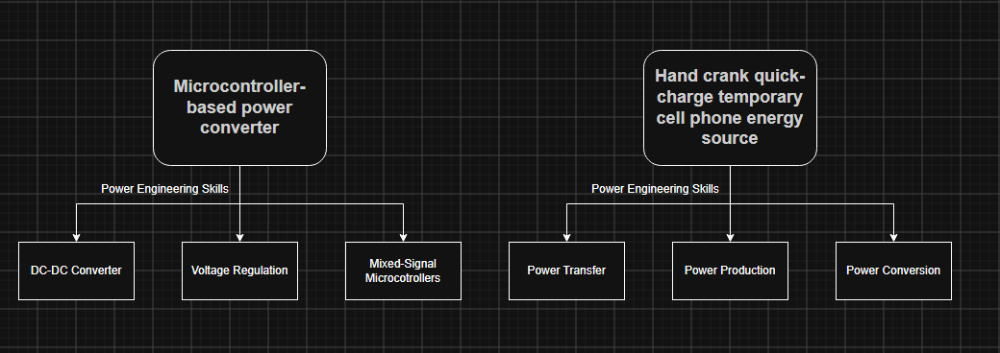

# Power Engineering University Plan
## Henry Nguyen

## Table of Contents
- [Purpose](#purpose)
- [Coursework at UWB](#coursework-at-uwb)
  - [Doing Well in Core EE Classes](#doing-well-in-core-ee-classes)
  - [Choosing EE Electives](#choosing-ee-electives)
- [Developing Personal Projects](#developing-personal-projects)
  - [Choosing Your Projects](#choosing-your-projects)
  - [Documenting Your Projects](#documenting-your-projects)
- [Building Connections at UWB](#buliding-connections-at-uwb)
  - [Going to Career Fairs](#going-to_career-fairs)
  - [Connecting With UWB Staff and Resources](#connecting-with-staff-and-resources)
- [References](#references)

## Purpose
As a Husky at UWB preparing to go into the industry after graduation, there are many things you can do to help you prepare to enter the workforce as a Power Engineer. By taking steps during your time at UWB, you can make your career search much easier and streamlined as you search for internships or a full-time job. The following sections describe how to best plan your coursework at UWB, create personal projects to put on your resume, and how to build your own network to help you succeed.
## Coursework at UWB
At UWB, there are many courses that you will be taking as an EE major. These courses help you build real-world skills and develop the foundations of being an engineer that you can apply to your career.
### Doing Well in Core EE Courses
As an EE Student, the goal of your main coursework classes is to build a good foundation in EE topics. Doing well in these courses is crucial to building a strong foundation in problem-solving and applied EE skills throughout your studies and career. By having a 3.5 or higher grade point average, you will look better as an internship applicant and as a newly graduated student to potential employers.

Utilize the resources that are offered at UWB. When you are doing homework or studying for an exam, go to the Qualitative Skills Center (QSC) and ask for help if you are struggling. Even though EE is considered one of the most difficult majors, UWB has a plethora of resources to help you succeed. Also make sure to budget your time properly. Do not wait until the last minute to do assignments just to get the grade. Give yourself enough time with the material to fully absorb it and do well in exams.
### Choosing EE Electives [^1]
During your senior year, there are a number of 400-level elective EE courses that you can take. By choosing the courses carefully, you can add specific skills and projects that relate to being a Power Engineer. If you have taken these courses and have these skills, then you will look much more attractive when you begin your search for internships or a job in the Power Engineering field.

Take B EE 450 Introduction to Power Electronics, which covers the basics of power electronics, including AC-DC, DC-DC, and DC-AC power converters. Take B EE 477 Power System Fundamentals, which covers basic power system analytics, steady-state analysis, transmission lines, and transformers. After taking these courses, take B EE 478 Power System Analysis, which dives much deeper into simulating power systems, power flow, and stability.
## Developing Personal Projects
Developing personal projects is a great way to add things to your resume and build skills to show off to employers.
### Choosing Your Projects
Choosing the right type of project is very important when thinking of showing off to employers. If you choose a project that doesn't display technical and problem-solving skills, then your project shows no value to  employers. On the other hand, if you choose a project that displays both of those, then it will be highly regarded and give you an edge over other applicants.

Choose projects that have skills that relate to your field of focus (in this case, Power Engineering). Consider projects that show your ability to design and test power systems, the transfer of power, storing power, and different types of power converters.
Figure 1 shows two examples of great projects and the skills that you develop while doing them [^2]. 
 
### Documenting Your Projects [^3]
How well you document your projects matters because it shows employers the skills and techniques you have developed and can apply. If the documentation is lacking, then employers may not see your project as noteworthy.

Take pictures of every step of the project, including the design phase, testing, and the final product. Put all of those pictures, along with an explanation and the skills used in each step, on a personal blog or website.
## References
[^1] : University of Washington, "ELECTRICAL ENGINEERING - UW BOTHELL," [Online]. Available: https://www.washington.edu/students/crscatb/bee.html#bee477. [Accessed 26 October 2026].

[^2] : The Grainger College of Engineering, "ECE 445 Project Ideas," [Online]. Available: https://energy.ece.illinois.edu/lab-resources/ece-445-project-ideas/. [Accessed 26 October 2026].

[^3] : "How to document personal projects?," Reddit, [Online]. Available: https://www.reddit.com/r/engineering/comments/4yp6aa/how_to_document_personal_projects/. [Accessed 26 October 2026].

