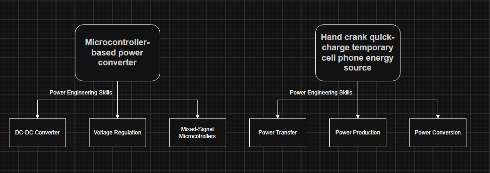

# Power Engineering University Plan
## Henry Nguyen

## Table of Contents
- [Purpose](#purpose)
- [Coursework at UWB](#coursework-at-uwb)
  - [Choosing EE Electives](#choosing-ee-electives)
- [Developing Personal Projects](#developing-personal-projects)
  - [Choosing Your Projects](#choosing-your-projects)
  - [Documenting Your Projects](#documenting-your-projects)
- [References](#references)

## Purpose
As a Husky at UWB preparing to go into the industry after graduation, there are many things you can do to help you prepare to enter the workforce as a Power Engineer. By taking steps during your time at UWB, you can make your career search much easier and streamlined as you search for internships or a full-time job. The following sections describe how to best plan your coursework at UWB, create personal projects to put on your resume, and how to build your own network to help you succeed.
## Coursework at UWB
At UWB, there are many courses that you will be taking as an EE major. These courses help you build real-world skills and develop the foundations of being an engineer that you can apply to your career.

### Choosing EE Electives [^1] [^2]
During your senior year, there are a number of 400-level elective EE courses that you can take. By choosing these courses carefully, you can add specific skills and projects that relate to being a Power Engineer. If you have taken these courses and have these skills, then you will look much more attractive to employers when you begin your search for internships or a job in the Power Engineering field.

Take B EE 450 Introduction to Power Electronics, which covers the basics of power electronics, including AC-DC, DC-DC, and DC-AC power converters. Take B EE 477 Power System Fundamentals, which covers basic power system analytics, steady-state analysis, transmission lines, and transformers. After taking these courses, take B EE 478 Power System Analysis, which dives much deeper into simulating power systems, power flow, and stability.
## Developing Personal Projects
Developing personal projects is a great way to add experience to your resume and build skills to show off to employers.
### Choosing Your Projects
Choosing the right type of project is very important when thinking of showing off to employers. If you choose a project that doesn't display technical and problem-solving skills, then your project shows no value to employers. On the other hand, if you choose a project that displays both of those, then it will be highly regarded and give you an edge over other applicants.

Choose projects that have skills that relate to your field of focus (in this case, Power Engineering). Choose projects that show your ability to design and test power systems, the transfer of power, storing power, and different types of power converters.
Figure 1 shows two examples of great projects and the skills that you develop while doing them [^3]. 
 
### Documenting Your Projects [^4]
How well you document your projects matters because it shows employers the skills and techniques you have developed and can apply. As you apply to jobs, employers ask you about your projects, and being prepared with documentation helps both you and the employer understand your engineering process. During an interview with Samuel Hong, he mentions that "regardless of what kind of project it is, they'll like it as long as you know the stuff you're talking about." [^5] If the documentation is lacking, then employers may not see your project as noteworthy. On the other hand, by being detailed with your documentation, it will show employers that you know these skills and are a desirable candidate.

Create a personal website where you can store all of your projects. Use resources like Google Sites to create your website. Take pictures of every step of your project, including the design phase, testing, and the final product to include in your website portfolio. Along with the photos, explain the purpose of your project, the design process, each iteration of your project, and what skills you learned and applied during your project. Make sure to emphasize the components that are most relevant to the employer. 
## References
[^1]: University of Washington, "ELECTRICAL ENGINEERING - UW BOTHELL," n.d., [Online]. Available: https://www.washington.edu/students/crscatb/bee.html#bee477. [Accessed 26 Oct 2026].

[^2]: T. Angelellaa, Interviewee, _Academic Advising Meeting_. [Interview]. 2 Nov 2026.

[^3]: The Grainger College of Engineering, "ECE 445 Project Ideas," n.d., [Online]. Available: https://energy.ece.illinois.edu/lab-resources/ece-445-project-ideas/. [Accessed 26 Oct 2026].

[^4]: WashU, "How to create an engineering portfolio," n.d., [Online]. Available: https://careers.washu.edu/resources/how-to-create-an-engineering-portfolio/. [Accessed 3 Nov 2026].

[^5]: S. Hong, Interviewee, _Personal Interview With Samuel Hong_. [Interview]. 1 Nov 2026.

Word Count: 627 words
